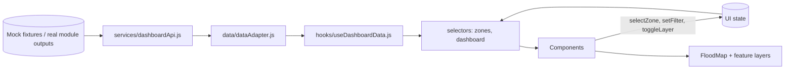

# HighWater Dashboard: Architecture (Member 1)

## 1. Stack

| Concern | Choice | Why |
|---|---|---|
| Framework and build | React + Vite | Fast dev server, simple build |
| Mapping | Leaflet + React Leaflet | Quick GeoJSON, markers, polylines, popups |
| Styling | Tailwind CSS | Responsive layout and design tokens |
| Charts | Recharts | Small, declarative charts |
| Icons | lucide-react | Consistent icon set |
| Tests | Vitest + React Testing Library | Adapter, selectors, components |

Not used: Redux or other global-state libraries, 3D globes, animation frameworks.

## 2. Layered design

Data flows in one direction. Components never touch raw backend shapes.



| Layer | File(s) | Responsibility | Must not |
|---|---|---|---|
| Service | `services/dashboardApi.js` | Fetch data, nothing else | Transform or interpret data |
| Adapter | `data/dataAdapter.js` | Map raw fields to the normalised UI model; validate | Contain UI code |
| Hook | `hooks/useDashboardData.js` | Load, refresh, expose status and data | Compute metrics |
| Selectors | `features/*/…Selectors.js`, `zoneUtils.js` | Derive stats, filtered and sorted lists, selected zone | Fetch or mutate |
| Components | `components/`, `features/map/` | Render | Fetch, score risk, compute routes |

**Rule:** the adapter is the only place that knows backend field names.

## 3. Folder structure

```
modules/dashboard/
├── public/mock-data/
│   ├── flood_extent.geojson
│   ├── zones.json
│   ├── blocked_roads.geojson
│   ├── facilities.geojson
│   └── routes.json
├── src/
│   ├── app/            App.jsx, DashboardLayout.jsx
│   ├── components/     Header, StatCard, FloodMap, MapControls, MapLegend,
│   │                   ZoneDetails, ZoneList, RiskDistributionChart,
│   │                   ImpactChart, FilterBar, LoadingState, EmptyState, ErrorState
│   ├── features/
│   │   ├── map/        FloodLayer, RiskLayer, RoadLayer, FacilityLayer, RouteLayer
│   │   ├── zones/      zoneSelectors.js, zoneUtils.js
│   │   └── dashboard/  dashboardSelectors.js
│   ├── data/           mockData.js, dataAdapter.js
│   ├── hooks/          useDashboardData.js, useMapLayers.js
│   ├── services/       dashboardApi.js
│   ├── config/         theme.js (all colours), constants.js
│   ├── styles/         index.css
│   ├── test/           ZoneList.test.jsx, ZoneDetails.test.jsx, dashboardSelectors.test.js, dataAdapter.test.js
│   └── main.jsx
├── .env.example
├── package.json
├── vite.config.js
└── README.md
```

Create files as needed; do not scaffold empty components for the sake of the tree.

## 4. State

One reducer or hook in `DashboardLayout`. Single source of truth.

```js
const initialDashboardState = {
  selectedZoneId: null,
  filters: { search: "", riskLevel: "ALL" },
  visibleLayers: { flood: true, risk: true, roads: true, facilities: true, routes: false },
  sortBy: "priority",
  dataStatus: "loading", // loading | ready | empty | error | stale
};
```

| Rule | Detail |
|---|---|
| Selection | `selectedZoneId` only. The details panel derives from it. No second copy. |
| Filtering | Derive the visible list from the full normalised array each render (memoised). Never keep a separate filtered copy. |
| Layers | Toggling flips `visibleLayers`; it never touches data or map view. |
| Stats and charts | Use the same dataset and the same filters policy, documented in `dashboardSelectors.js`. |

## 5. Data contracts

All fields below are inputs to the adapter. Unknown extra fields are ignored. Missing optional fields become `null`.

### 5.1 `zones.json`
```json
{
  "schema_version": "1.0",
  "generated_at": "2026-10-13T10:00:00Z",
  "data_mode": "demo",
  "zones": [
    {
      "zone_id": "zone-001",
      "name": "Zone 001",
      "risk_level": "HIGH",
      "risk_score": 82,
      "flooded_percent": 68,
      "flooded_area_km2": 2.4,
      "exposed_buildings": 34,
      "accessibility": "LIMITED",
      "reasons": ["High flood coverage", "Many exposed buildings"],
      "geometry": null
    }
  ]
}
```
Optional extension fields (render only if present): `confidence`, `rank_p10`, `rank_p90`, `provenance`, `needs_survey`.

### 5.2 `flood_extent.geojson`
FeatureCollection of Polygon or MultiPolygon. Properties: `feature_id`, `zone_id` (optional), `flood_status`, optional `provenance`. Coordinates `[lng, lat]`, closed rings.

### 5.3 `blocked_roads.geojson`
FeatureCollection of LineString. Properties: `road_id`, `reason`, optional `provenance` (`derived` from flood overlay or `simulated` from user closure).

### 5.4 `facilities.geojson`
FeatureCollection of Point. Properties: `facility_id`, `name`, `type` (`hospital` | `shelter` | `depot` | other).

### 5.5 `routes.json`
```json
{
  "routes": [
    {
      "route_id": "route-001",
      "status": "OK",
      "distance_m": 6400,
      "eta_minutes": 18,
      "provenance": "derived",
      "geometry": { "type": "LineString", "coordinates": [[77.59, 12.97], [77.60, 12.98]] }
    }
  ]
}
```
`status` is one of `OK`, `UNREACHABLE`, `UNKNOWN`. No geometry means no line is drawn.

### 5.6 Normalised UI model
```js
{
  zoneId: "zone-001",
  name: "Zone 001",
  riskLevel: "HIGH",          // HIGH | MEDIUM | LOW | UNKNOWN
  riskScore: 82,              // 0 to 100 or null
  floodedPercent: 68,         // or null
  floodedAreaKm2: 2.4,        // or null
  exposedBuildings: 34,       // or null
  accessibility: "LIMITED",   // OPEN | LIMITED | BLOCKED | UNKNOWN
  reasons: [],
  hasGeometry: true,
  provenance: null,
  confidence: null
}
```

### 5.7 Adapter rules
1. Throw a descriptive error if the top-level payload is not the expected shape.
2. Unknown or missing `risk_level` becomes `UNKNOWN`. Never `LOW`.
3. Non-finite numbers become `null`.
4. If a score arrives on a 0.0 to 1.0 scale, multiply by 100 and record the original scale in a dev-only field.
5. Validate coordinates: longitude in [-180, 180], latitude in [-90, 90]. Warn if values look swapped. Drop invalid features and report a count to the UI.
6. Join zone geometry by `zone_id`; zones without geometry stay in the list.

## 6. Map architecture

`FloodMap.jsx` is a pure renderer.

```jsx
<FloodMap
  floodGeoJSON={floodGeoJSON}
  riskZones={riskZones}
  blockedRoads={blockedRoads}
  facilities={facilities}
  route={selectedRoute}
  selectedZoneId={selectedZoneId}
  visibleLayers={visibleLayers}
  onZoneSelect={handleZoneSelect}
/>
```

| Concern | Approach |
|---|---|
| Layer isolation | Each of the five layers is a child component wrapped in an error boundary |
| Coordinates | GeoJSON layers use `[lng, lat]` natively. Hand-built polylines or markers need `[lat, lng]`; convert in one helper, `toLatLng()`. |
| Selection | Layer click calls `onZoneSelect(zoneId)`. Style is derived from `selectedZoneId`. |
| Fit to zone | `useMap()` + `flyToBounds` on selection from the list |
| Resize | Call `map.invalidateSize()` when the container resizes (drawer open/close, breakpoint) |
| Styling | All colours come from `config/theme.js` |
| Determinism | Mock geometry is fixed; no runtime random generation |

## 7. Error handling

| Failure | Behaviour |
|---|---|
| Fetch fails | `dataStatus = error`, visible message, retry button, rest of shell still renders |
| Empty `zones` array | `dataStatus = empty`, explanatory empty state, no zero-risk map |
| Bad GeoJSON in one layer | That layer shows an inline warning; base map and others continue |
| Missing numeric field | "Not available" in the UI |
| Stale data | Banner with last-updated time when older than `VITE_STALE_MINUTES` |
| Refresh while loading | Ignored; in-flight guard prevents duplicates |

## 8. Configuration

`.env.example`
```
VITE_DATA_SOURCE=mock          # mock | mock-dernau | api
VITE_API_BASE_URL=             # set only once endpoints are agreed
VITE_STALE_MINUTES=60
VITE_TILE_URL=https://tile.openstreetmap.org/{z}/{x}/{y}.png
VITE_TILE_ATTRIBUTION=© OpenStreetMap contributors
```
No secrets in frontend code. Any tile provider that needs a key is out of scope.

### 8.1 Data Sources
- **`mock`**: Default demonstration dataset based on Bengaluru, Karnataka study area fixtures in `/mock-data/` (`zones.json`, `flood_extent.geojson`, `blocked_roads.geojson`, `facilities.geojson`, `routes.json`). Displays generic `DEMO MODE` header badge.
- **`mock-dernau`**: Realistic flood operations demonstration dataset derived from the SpaceNet 8 flood dataset for Dernau (Ahr valley, Germany) in `/mock-data-dernau/`. Includes 38 zones, 196 flood polygons, 45 blocked road segments, 3 critical facilities, 3 evacuation corridors, and 759 exposed buildings (6th map overlay). Displays `"Historical ground truth (SpaceNet 8)"` header badge (never claims live or real-time).
- **`api`**: Live backend integration. Requires explicit configuration of `VITE_API_BASE_URL` and all resource paths (`VITE_API_ZONES_PATH`, `VITE_API_FLOOD_PATH`, `VITE_API_ROADS_PATH`, `VITE_API_FACILITIES_PATH`, `VITE_API_ROUTES_PATH`). Throws clear configuration errors if required variables are omitted.

## 9. Test architecture

| Level | Tooling | Targets |
|---|---|---|
| Unit | Vitest | `dataAdapter`, `zoneUtils`, selectors, `toLatLng`, coordinate validation |
| Component | RTL | `ZoneList`, `ZoneDetails`, `FilterBar`, empty and error states |
| Manual | Browser | Map rendering, pan and zoom, popups, layer toggles, responsive layouts |

## 10. Integration plan

1. Agree schemas and endpoint names with each module owner.
2. Switch `VITE_DATA_SOURCE` to `api` and implement the fetch behind the existing service function.
3. Run real payloads through the adapter; fix mapping there only.
4. Re-run the full test list, including malformed payloads.
