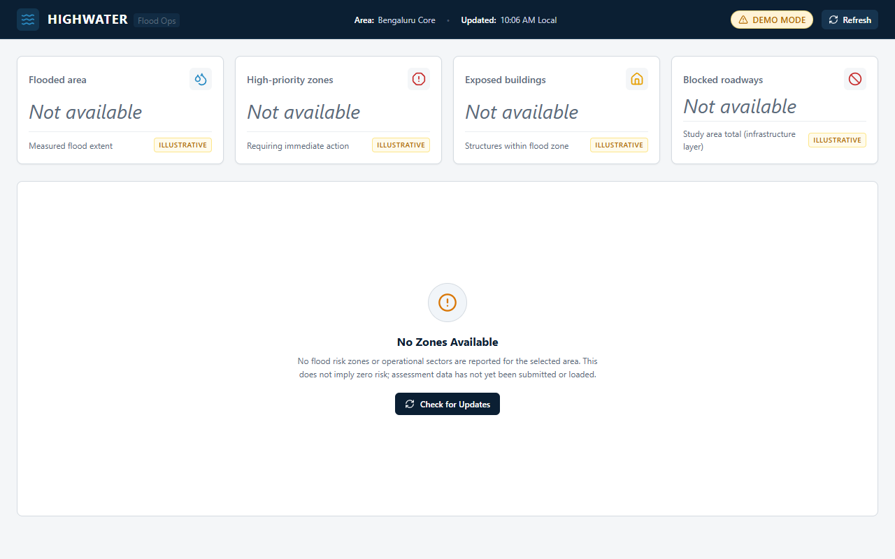
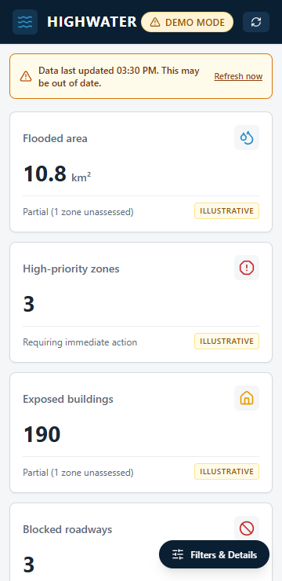
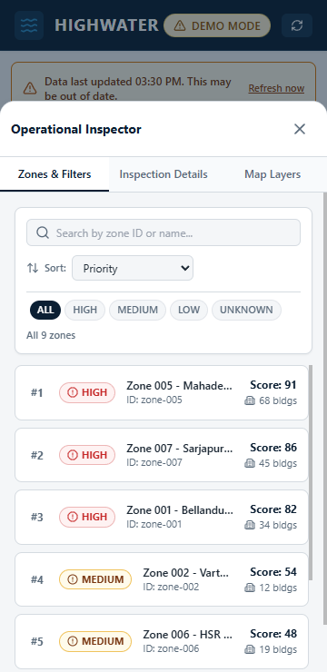

# HighWater — Flood Operations Dashboard (Module: Member 1)

Standalone, responsive, production-ready flood response dashboard engineered for tactical emergency commanders and municipal operations centers. Built with React, Vite, Leaflet, and Tailwind CSS.

---

## 1. Quick Start & Setup

### Prerequisites
- Node.js >= 18
- npm >= 9

### Installation
From the repository root or module directory:
```bash
cd modules/dashboard
npm install
```

### Environment Configuration
Copy `.env.example` to `.env` (optional, defaults provided in code):
```bash
cp .env.example .env
```

Configured environment variables:
| Variable | Default | Purpose |
|---|---|---|
| `VITE_DATA_SOURCE` | `mock` | Data source switcher (`mock`, `mock-dernau`, `mock-floodwatch`, or `api`) |
| `VITE_API_BASE_URL` | `http://localhost:8000/api` | Backend API base URL when in `api` mode |
| `VITE_REFRESH_INTERVAL_MS` | `30000` | Auto-refresh poll interval in milliseconds |
| `VITE_STALE_MINUTES` | `60` | Age threshold for displaying stale-data warning banner |
| `VITE_MAP_TILE_URL` | `https://{s}.tile.openstreetmap.org/{z}/{x}/{y}.png` | Base map tile provider template |

### Running the App
```bash
# Start local development server with HMR
npm run dev

# Build production bundle with Vite
npm run build

# Preview production build locally
npm run preview
```

### Running Tests
```bash
# Run unit and component test suite (Vitest + React Testing Library)
npm test

# Run tests once with coverage report
npm test -- --run --coverage
```

---

## 2. Architecture & Data Contracts

Data path strictly adheres to a unidirectional architecture:
```
Service (dashboardApi) -> Adapter (dataAdapter) -> Hook (useDashboardData) -> Selectors (dashboardSelectors) -> Components
```

### Core Design Rules
- **Layer Isolation**: Components and Leaflet map layers never call `fetch()`. Only `dataAdapter.js` knows backend field names.
- **Data Integrity**: Missing data is never coerced to `0` or `LOW`. Null numeric metrics display as `"Not available"` and are excluded from metric sums. Unknown risk categories normalize strictly to `UNKNOWN` with distinct visual styling.
- **Coordinate System**: All geospatial coordinates conform strictly to GeoJSON RFC 7946: `[longitude, latitude]` in EPSG:4326. Coordinates are automatically converted to Leaflet `[lat, lng]` within layer components.
- **Fault-Tolerant Geometry**: Unclosed rings, coordinate boundary violations, or missing geometries are isolated, logged, and surfaced in the layer warning banner without crashing the application.
- **In-flight Request Guard**: The dashboard prevents duplicate concurrent network fetches during rapid manual refresh clicks.

### Mock Fixtures & Demonstration Datasets

The dashboard supports three independent fixture datasets configured via `VITE_DATA_SOURCE`:

#### 1. Synthetic Fixtures (`VITE_DATA_SOURCE=mock`, default)
Located in `public/mock-data/`:
- `zones.json`: Assessment zones (Bengaluru, Karnataka) covering HIGH, MEDIUM, LOW, UNKNOWN, un-geometried `zone-009`, and null-metric edge cases.
- `flood_extent.geojson`: Inundation polygon contours.
- `facilities.geojson`: Critical infrastructure points (hospitals, shelters, command centers).
- `blocked_roads.geojson`: Flooded and impassable road line segments.
- `routes.json`: Primary and secondary evacuation routes with status.

#### 2. SpaceNet 8 Dernau Historical Dataset (`VITE_DATA_SOURCE=mock-dernau`)
Located in `public/mock-data-dernau/`:
- **Source & Attribution**: Derived from the SpaceNet 8 Flood Dataset (Maxar Technologies) and OpenStreetMap for Dernau (Ahr valley, Germany), licensed under CC BY-SA 4.0. Unmodified source copies are preserved in `modules/dashboard/integration-samples/`.
- **Operational Reality**: Generated deterministically by `scripts/build-dernau-demo.mjs` and verified by `scripts/validate-dernau-demo.mjs`.
- **Contract-Perfect Resources**:
  - `zones.json`: 38 assessment zones with derived risk scores, explicit reasons, and designated test cases (`zone-018` for UNKNOWN assessment; `zone-005` with withheld building count displaying as `"Not assessed"`).
  - `flood_extent.geojson`: 196 flood polygons derived from labelled building and road inundation points within the AOI.
  - `blocked_roads.geojson`: 45 impassable road segments labelled flooded in ground-truth data.
  - `facilities.geojson`: 3 critical facilities (fire station, hospital, community hall).
  - `routes.json`: 3 evacuation routes (2 clear, 1 degraded corridor).
  - `buildings_exposed.geojson`: 759 exposed building footprints (6th map overlay layer).
- **Honest UI Presentation**:
  - Displays `"Historical ground truth (SpaceNet 8)"` header badge with amber styling (WCAG AA 5.39:1 contrast). Never claims live or real-time.
  - Stat cards visibly clarify: Flooded area as derived from labelled flooded buildings/roads (not a measured water boundary), Blocked roadways as roads labelled flooded in ground truth, and designated test cases explicitly disclosed.
  - Illustrative risk score disclaimer banner displayed.
  - Fitted coordinate bounds automatically computed to encompass Dernau AOI geometry.

#### 3. FloodWatch SegFormer-B0 Demonstration Dataset (`VITE_DATA_SOURCE=mock-floodwatch`)
Located in `public/mock-data-floodwatch/`:
- **Source & Attribution**: SpaceNet 8 Germany AOI flood labels and local offline SegFormer-B0 inference predictions exported by FloodWatch.
- **Contract-Perfect Resources**:
  - `flood_extent_groundtruth.geojson`: 822 features (SpaceNet 8 human annotations: building polygons and road lines labelled flooded). Provenance: `"observed"`.
  - `flood_extent_predicted_fast.geojson`: 146 flood polygons produced by SegFormer-B0 fast mode inference. Provenance: `"derived"`.
  - `flood_extent_predicted_accurate.geojson`: 255 flood polygons produced by SegFormer-B0 sliding-window accurate mode inference. Provenance: `"derived"`.
  - `zones.json`: 14 Germany AOI demonstration tile zones (`0_41_58`, `0_27_68`, `0_15_63`, etc.).
- **Adapter Validation & Integrity**:
  - Adapted via `adaptFloodWatchCollection` and `adaptFloodWatchFeature` in `src/data/dataAdapter.js`.
  - Validates RFC 7946 EPSG:4326 `[lng, lat]` coordinates and closed exterior polygon rings; invalid geometries are safely skipped and logged in dropped feature alerts.
  - Explicitly preserves `provenance`, `tile_id`, `mode`, `mask_pixels`, `in_training_pool`, and `feature_type`, leaving missing fields `null` (never defaulted).
- **Training Pool Transparency**:
  - Every tile with flood damage in this demonstration was in the SegFormer-B0 model's training pool. The dashboard explicitly discloses that agreement between observed and predicted layers is not a held-out test result. No machine learning evaluation metrics (IoU, recall) are calculated on the frontend.

---

## 3. Filter Policy & State Rules

### Filter Scope
| Metric / Component | Follows Active Filter? | Documentation & Rationale |
|---|---|---|
| **Flooded area** | Yes | Sum of inundated hectares across active filtered zones. |
| **High-priority zones** | Yes | Count of filtered zones requiring immediate tactical response. |
| **Exposed buildings** | Yes | Sum of buildings at risk across filtered zones. Nulls excluded. |
| **Blocked roadways** | **No (Infrastructure-wide)** | Infrastructure-wide total from `blockedRoads.geojson`. Not partitioned by zone. |
| **Risk Distribution Chart** | Yes | Category breakdown (HIGH, MEDIUM, LOW, UNKNOWN) for active filtered zones. |
| **Top Impacted Zones Chart** | Yes | Ranked list of filtered zones by risk score. Null scores excluded. |

When a filter is active, stat cards visibly display the contextual badge:
`"Filtered view: N of M zones"`.

---

## 4. State Management & Fallbacks

- **Loading State**: Accessible skeleton cards, animated loading pulse, and non-blocking layout loading screen.
- **Empty State**: Friendly operational prompt when no assessment zones are loaded or query criteria return 0 matches.
- **Error State & Working Retry**: Non-crashing error boundary with descriptive error message and interactive "Retry Request" trigger.
- **Stale Data Banner**: Prominent top alert triggered when payload `generated_at` exceeds `VITE_STALE_MINUTES`.
- **Malformed GeoJSON Resilience**: Catches invalid geometries, syntax errors, or coordinate faults at adapter level; isolates broken layers and presents inline layer alerts while the remaining map operates uninterrupted.
- **Offline Base Map Fallback**: When tile network requests fail or are blocked, the map provides an accessible neutral background (`#e2e8f0`) with an operational notice, preserving interactive vector overlays (flood extents, routes, facilities).
- **Responsive Mobile Drawer & Tablet Layout**: On tablet (640px - 1023px), maintains a 2-column layout with Map and Side Panel side-by-side. On mobile (< 640px), operational controls collapse into a bottom drawer with dedicated tab navigation, preventing horizontal overflow (verified at 360px) and triggering Leaflet `map.invalidateSize()` on drawer toggle.

---

## 5. Manual Map Verification Checklist

1. [x] **Base Map Loading**: OpenStreetMap tiles render smoothly without gray tiles at zoom level 12 (centered on Houston, TX `[29.7604, -95.3698]`).
2. [x] **Layer Toggling**: Check/uncheck each overlay in Layer Controls:
   - Flood Extent (inundation contours)
   - Risk Heatmap (color-coded assessment polygons)
   - Critical Facilities (custom Lucide SVG divIcons for hospitals, schools, shelters)
   - Blocked Roads (red segmented corridors)
   - Evacuation Routes (emerald clear routes, amber degraded routes)
3. [x] **Fault Isolation**: Disabling or breaking one layer does not affect other visible layers or reset map center.
4. [x] **Bidirectional Selection**:
   - Clicking a polygon highlights the zone with an indigo border, opens details, and scrolls the zone row into view.
   - Clicking a list row highlights the zone and flies the map viewport to its bounding box (`map.flyToBounds`).
   - Selecting a non-spatial zone (`zone-009`) updates details cleanly without attempting map pan or throwing exceptions.
5. [x] **Reset Extent**: Clicking "Reset extent" restores default study area coordinates and zoom level.
6. [x] **Keyboard Navigation**: Tab key cycles through layer checkboxes, filter buttons, search input, and zone list rows with visible focus rings.

---

## 6. Screenshot Gallery

All operational states captured from headless Chrome test runs:

### Desktop Views & Operational States
| State | Screenshot |
|---|---|
| **Full Desktop Dashboard (1280px)** |  |
| **Loading State** |  |
| **Empty State** |  |
| **Error State with Retry** |  |
| **Stale Data Banner** |  |
| **Malformed GeoJSON Handling** |  |
| **Offline Tile Fallback** |  |

### Mobile Views (360px Viewport)
| View | Screenshot |
|---|---|
| **Mobile Map View** |  |
| **Mobile Drawer (Controls Open)** |  |

---

## 7. Known Limitations & Known Deviations

### Known Limitations
- **Single-module scope**: Member 1 module operates in standalone demonstration mode using validated GeoJSON fixtures. API endpoints in `dashboardApi.js` fall back to mock data when `VITE_DATA_SOURCE=mock`.
- **WebGL / 3D**: Redux, 3D globes, and heavy canvas animation frameworks are deliberately excluded in compliance with hackathon architecture rules to ensure battery-friendly performance on tactical field laptops.
- **Leaflet Marker Icons**: Standard Leaflet PNG markers are replaced with inline Lucide SVG `L.divIcon` to prevent path-resolution issues under Vite asset bundling.

### Known Deviations
- **DEMO Badge Text Contrast**: Adjusted from `#B26A00` to `#965300` on `#FFF3D6` to satisfy WCAG 2.1 AA text contrast requirement (5.39:1 vs the original 3.84:1). The original token remains preserved in `theme.js` as `specText`.
- **Tailwind Default Palette**: Selective semantic use of Tailwind utility classes (`slate-50/100/200` for table headers, panel dividers, and offline tile fallback; `amber-50/600/900`, `red-50/100`, `emerald-50/600`, and `gray-100/700` for accessible status pills and alert banners) extending base theme tokens.
- **Marker Drop Shadow**: `rgba(0,0,0,0.3)` in `FacilityLayer.jsx` for DOM marker elevation box shadow.

---

## 7. Mesh Sync (Local Network)

HighWater includes an isolated, zero-internet **Mesh Sync** capability designed for emergency deployment when municipal cellular networks or ISP infrastructure are severed. Multiple field devices (laptops, rugged tablets, and responder smartphones) connected to a common local hotspot can exchange ground-truth survey observations in real time without external connectivity.

### Dependencies
The lightweight WebSocket relay requires the `ws` package:
```bash
# ws is installed in modules/dashboard/package.json
npm install ws
```

### 1. Running the Mesh Relay Server
Start the in-memory WebSocket relay on port `8787` (bound to `0.0.0.0`):
```bash
node scripts/mesh-relay.mjs
```
The relay will output:
```
[Mesh Relay] HighWater local mesh relay listening on ws://0.0.0.0:8787
[Mesh Relay] In-memory mode active. Zero external dependencies / no internet required.
```

### 2. Running the Dashboard for Local Devices
Launch the dashboard Vite development server exposed to your local network:
```bash
npm run dev -- --host 0.0.0.0
```
Vite will output the Network URL (e.g., `http://192.168.1.50:5173/`).

### 3. Opening on Field Phones & Tablets
1. Connect field devices (e.g., responder phone or tablet) to the same Wi-Fi router or portable mobile hotspot as the host laptop.
2. Locate the laptop's LAN IP address on Windows via `ipconfig` (e.g., `192.168.1.50`).
3. Open mobile browser and navigate to:
   ```
   http://<LAPTOP_LAN_IP>:5173
   ```
   *(Example: `http://192.168.1.50:5173`)*
4. The dashboard automatically discovers the mesh relay at `ws://<LAPTOP_LAN_IP>:8787` (or uses `VITE_MESH_RELAY_URL` if explicitly set).
5. The Header badge will update to `Mesh active - N peers connected` with accessible `aria-live="polite"` announcements.

### Windows Firewall Configuration Note
If mobile devices cannot connect to the laptop:
- Ensure incoming TCP connections on port **5173** (Vite HTTP) and port **8787** (WebSocket Relay) are allowed through Windows Defender Firewall.
- When prompted upon launching Node, check "Allow access on Private networks".

### Known Limitations
- **In-memory storage**: The relay retains survey updates in RAM; there is no SQL or disk database.
- **No authentication / encryption**: Designed strictly for trusted tactical LAN/hotspot operation during disconnected emergencies.
- **Ephemeral session state**: Updates are cleared when the relay process terminates or restarts.
- **Base map internet dependency**: Base map satellite or street raster tiles require internet access (or browser cache). All geospatial feature overlays (flooded sectors, critical facilities, blocked routes) and field survey records render completely offline.

---

## 8. Integration Questions for Module Owners

Per PRD.md section 6, agreements with module owners are required before live API switch:

### Member 2 — Flood Analysis & Forecasting Engine
- **Endpoint Path**: What is your canonical endpoint path? (Configured via `VITE_API_FLOOD_PATH`; no default guessed).
- **Schema & CRS**: Can you guarantee RFC 7946 GeoJSON format in EPSG:4326 with `[longitude, latitude]` coordinate order and closed exterior polygon rings?
- **Depth Units & Contours**: Are water depths provided in meters (`water_depth_m`) or centimeters? Are inundation areas pre-classified into depth contours?
- **Cadence & Timestamps**: What is your forecast regeneration interval, and is `forecast_timestamp` guaranteed on every payload?
- **Provenance**: Will features include explicit provenance flags (`observed`, `derived`, `simulated`)?

### Member 3 — Risk Assessment & Tactical Prioritization
- **Endpoint Path**: What is your canonical endpoint path? (Configured via `VITE_API_ZONES_PATH`; no default guessed).
- **Risk Scale**: Is the risk score normalized from 0 to 100? Can scores be null for newly formed or unassessed sectors?
- **Categorization**: Are risk levels strictly `HIGH`, `MEDIUM`, `LOW`, and `UNKNOWN`?
- **Survey Flags**: How are zones needing physical reconnaissance identified (e.g., `needs_survey: true`)?
- **Geometry Linkage**: For non-spatial staging zones (e.g., `zone-009`), is `geometry: null` with `has_geometry: false` guaranteed?

### Member 4 — Evacuation Routing & Infrastructure Blockages
- **Endpoint Paths**: What are your canonical endpoint paths for blocked roads and evacuation corridors? (Configured via `VITE_API_ROADS_PATH` and `VITE_API_ROUTES_PATH`; no defaults guessed).
- **Road Segment Geometry**: Are blocked roads supplied as GeoJSON `MultiLineString` or `LineString`? What attribute names convey obstruction reason and severity?
- **Route Clearance**: What field flags route viability (e.g., `status: "CLEAR" | "DEGRADED" | "IMPASSABLE"`)?
- **Coordinate Conventions**: Do all route vertices strictly adhere to EPSG:4326 `[lng, lat]`?

---

## 9. Changelog

- **Phase 1: Setup & Scaffold**:
  - Initialized Vite + React scaffold, Tailwind CSS configuration with centralized `theme.js`.
  - Configured Vitest + React Testing Library with test setup and smoke tests.
- **Phase 2: Layout & Data Foundation**:
  - Implemented mock GeoJSON fixtures meeting all schema and test criteria.
  - Implemented `dataAdapter.js`, `useDashboardData.js`, stat summary cards, and responsive 3-column layout.
- **Phase 3: Interactive Map Layers**:
  - Integrated Leaflet and React Leaflet with custom fault-isolated layer components (`FloodLayer`, `RiskLayer`, `FacilityLayer`, `RoadLayer`, `RouteLayer`).
  - Added extent controls, layer toggle panel, and divIcon markers.
- **Phase 4: State Wiring & Bidirectional Interaction**:
  - Wired bidirectional selection between polygon clicks and list rows.
  - Added `ZoneSearch`, `ZoneFilter`, `ZoneList`, `ZoneDetails`, `RiskDistributionChart`, and `ImpactChart`.
  - Established filter policy and verified in-flight request deduplication.
- **Phase 5: Test, Polish & Resilience**:
  - Implemented `LoadingState`, `EmptyState`, and `ErrorState` with retry callback.
  - Added `StaleBanner` for data freshness alerts.
  - Added malformed GeoJSON handling and offline tile fallback.
  - Implemented mobile bottom drawer with tab switcher and `map.invalidateSize()` resize handler.
  - Completed accessibility pass (ARIA attributes, 2px focus ring, high-contrast risk labels).
- **Dernau Historical Demonstration (SpaceNet 8)**:
  - Deterministically built and validated contract-perfect demonstration dataset in `public/mock-data-dernau/` from SpaceNet 8 flood data for Dernau (Ahr valley, Germany).
  - Wired `VITE_DATA_SOURCE=mock-dernau` into `dashboardApi.js`, supporting dynamic data-bounds auto-fitting (`computeDataBounds`).
  - Integrated 6th map overlay (`BuildingLayer`) for exposed building footprints with dedicated toggle and legend entry.
  - Added honest UI labelling: `"Historical ground truth (SpaceNet 8)"` header badge, provenance badges (`derived`, `simulated`), disclaimer for demo risk scores, and `"Not assessed"` status for zones with withheld metrics (`zone-005`).
